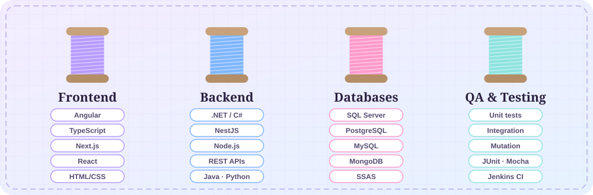

<a href="README.md">🇬🇧 English</a> · <b>🇪🇸 Español</b>

  
  
  
  

  <a href="#proyectos">✂️ Proyectos</a> ·
  <a href="#stack">🧵 Stack</a> ·
  <a href="#actividad">🪡 Actividad</a> ·
  <a href="#sobre-mi">👗 Sobre mí</a> ·
  <a href="#contacto">💌 Contacto</a>

  Soy <b>Ingeniera de Software</b> (8.º semestre, Universidad Técnica de Ambato 🇪🇨). Construyo <b>frontends</b>, diseño <b>bases de datos</b> y rompo cosas a propósito en <b>QA</b>. 
  Confecciono software como un diseñador confecciona ropa: <b>a medida, probado y hecho para quedar perfecto</b>.

<h2 id="proyectos" align="center"></h2>

Cada pieza nace de un problema real, se cose con código limpio y se revisa costura por costura.

  
  

  
  

  
  

  

<h2 id="stack" align="center"></h2>

  

  

<h2 id="actividad" align="center"></h2>

<picture>
  <source media="(prefers-color-scheme: dark)" srcset="https://raw.githubusercontent.com/Jhanina03/Jhanina03/output/snake-dark.svg">
  
</picture>

<h2 id="sobre-mi" align="center"></h2>

  

  🎨 Angular · TypeScript · Next.js &nbsp;|&nbsp; 🗄️ SQL Server · PostgreSQL · MongoDB &nbsp;|&nbsp; 🔍 Pruebas unitarias, de integración y de mutación · CI con Jenkins &nbsp;|&nbsp; 🧠 Proyectos de IA

<h2 id="contacto" align="center"></h2>

  Disponible para <b>prácticas, puestos junior y trabajo remoto</b> desde Ambato, Ecuador. 
  ¿Necesitas un frontend a la medida, una base de datos que no pierda la forma o un ojo de QA en tus costuras? Hablemos.

  
  
  
  

<a href="#top">↑ Volver arriba</a>

