

<a href="README.md">🇬🇧 English</a> · <b>🇪🇸 Español</b>

<a href="https://jhanina03.github.io/?lang=es">
  <picture><source media="(prefers-color-scheme: light)" srcset="assets/light/hero-es.svg"></picture>
</a>

  <a href="https://jhanina03.github.io/?lang=es"><picture><source media="(prefers-color-scheme: light)" srcset="assets/light/cta-portfolio-es.svg"></picture></a>
  <a href="https://jhanina03.github.io/game.html?lang=es"><picture><source media="(prefers-color-scheme: light)" srcset="assets/light/cta-play-es.svg"></picture></a>
  <a href="https://jhanina03.github.io/cv.html?lang=es"><picture><source media="(prefers-color-scheme: light)" srcset="assets/light/cta-cv-es.svg"></picture></a>
  <a href="#contacto"><picture><source media="(prefers-color-scheme: light)" srcset="assets/light/cta-talk-es.svg"></picture></a>

  <a href="#proyectos">✂️ Proyectos</a> ·
  <a href="#stack">🧵 Stack</a> ·
  <a href="#actividad">🪡 Actividad</a> ·
  <a href="#sobre-mi">👗 Sobre mí</a> ·
  <a href="#contacto">💌 Contacto</a>

  Soy <b>Ingeniera de Software</b> (8.º semestre, Universidad Técnica de Ambato 🇪🇨). Construyo <b>frontends</b>, diseño <b>bases de datos</b> y rompo cosas a propósito en <b>QA</b>. 
  Me gustan las interfaces que se ven bien, los datos que tienen sentido y el código probado antes de salir.

<h2 id="proyectos" align="center"><picture><source media="(prefers-color-scheme: light)" srcset="assets/light/h1-es.svg"></picture></h2>

Algunas cosas que he construido recientemente.

  <a href="https://jhanina03.github.io/?lang=es"><picture><source media="(prefers-color-scheme: light)" srcset="assets/light/card-portfolio-es.svg"></picture></a>
  <a href="https://jhanina03.github.io/archive.html?lang=es#fashion"><picture><source media="(prefers-color-scheme: light)" srcset="assets/light/card-fashionia-es.svg"></picture></a>

  <a href="https://github.com/Jhanina03/chat-basico"><picture><source media="(prefers-color-scheme: light)" srcset="assets/light/card-chat-es.svg"></picture></a>
  <a href="https://github.com/Jhanina03/mnist"><picture><source media="(prefers-color-scheme: light)" srcset="assets/light/card-mnist-es.svg"></picture></a>

  <a href="https://feriauto-juego.vercel.app"><picture><source media="(prefers-color-scheme: light)" srcset="assets/light/card-feriauto-es.svg"></picture></a>
  <a href="https://github.com/Jhanina03/APE7-proyectogpis"><picture><source media="(prefers-color-scheme: light)" srcset="assets/light/card-gpis-es.svg"></picture></a>

  <a href="https://github.com/Jhanina03?tab=repositories"><picture><source media="(prefers-color-scheme: light)" srcset="assets/light/cta-repos-es.svg"></picture></a>

<h2 id="stack" align="center"><picture><source media="(prefers-color-scheme: light)" srcset="assets/light/h2-es.svg">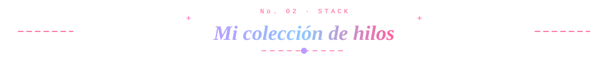</picture></h2>

  <picture><source media="(prefers-color-scheme: light)" srcset="assets/light/stack-es.svg"></picture>

  

<h2 id="actividad" align="center"><picture><source media="(prefers-color-scheme: light)" srcset="assets/light/h3-es.svg">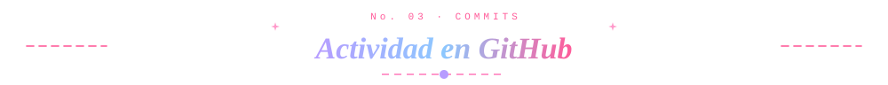</picture></h2>

<picture>
  <source media="(prefers-color-scheme: dark)" srcset="https://raw.githubusercontent.com/Jhanina03/Jhanina03/output/snake-dark.svg">
  
</picture>

<h2 id="sobre-mi" align="center"><picture><source media="(prefers-color-scheme: light)" srcset="assets/light/h4-es.svg"></picture></h2>

  <picture><source media="(prefers-color-scheme: light)" srcset="assets/light/about-es.svg"></picture>

  🎨 Angular · TypeScript · Next.js &nbsp;|&nbsp; 🗄️ SQL Server · PostgreSQL · MongoDB &nbsp;|&nbsp; 🔍 Pruebas unitarias, de integración y de mutación · CI con Jenkins &nbsp;|&nbsp; 🧠 Proyectos de IA

<h2 id="contacto" align="center"><picture><source media="(prefers-color-scheme: light)" srcset="assets/light/h5-es.svg"></picture></h2>

  Disponible para <b>prácticas, puestos junior y trabajo remoto</b> desde Ambato, Ecuador. 
  ¿Tienes un proyecto o un puesto en mente? Me encantaría saberlo.

  
  
  
  

<a href="https://jhanina03.github.io/?lang=es"><picture><source media="(prefers-color-scheme: light)" srcset="assets/light/footer-es.svg"></picture></a>

<a href="#top">↑ Volver arriba</a>

