

<b>🇬🇧 English</b> · <a href="README.es.md">🇪🇸 Español</a>

<a href="https://jhanina03.github.io/">
  <picture><source media="(prefers-color-scheme: light)" srcset="assets/light/hero.svg"></picture>
</a>

  <a href="https://jhanina03.github.io/"><picture><source media="(prefers-color-scheme: light)" srcset="assets/light/cta-portfolio.svg"></picture></a>
  <a href="https://jhanina03.github.io/game.html"><picture><source media="(prefers-color-scheme: light)" srcset="assets/light/cta-play.svg"></picture></a>
  <a href="https://jhanina03.github.io/cv.html"><picture><source media="(prefers-color-scheme: light)" srcset="assets/light/cta-cv.svg"></picture></a>
  <a href="#contact"><picture><source media="(prefers-color-scheme: light)" srcset="assets/light/cta-talk.svg"></picture></a>

  <a href="#projects">✂️ Projects</a> ·
  <a href="#stack">🧵 Stack</a> ·
  <a href="#activity">🪡 Activity</a> ·
  <a href="#about">👗 About</a> ·
  <a href="#contact">💌 Contact</a>

  I'm a <b>Software Engineer</b> (8th semester, Universidad Técnica de Ambato 🇪🇨) who builds <b>frontends</b>, designs <b>databases</b> and breaks things on purpose in <b>QA</b>. 
  I like interfaces that look good, data that makes sense and code that's tested before it ships.

<h2 id="projects" align="center"><picture><source media="(prefers-color-scheme: light)" srcset="assets/light/h1.svg"></picture></h2>

Some of the things I've built recently.

  <a href="https://jhanina03.github.io/"><picture><source media="(prefers-color-scheme: light)" srcset="assets/light/card-portfolio.svg"></picture></a>
  <a href="https://jhanina03.github.io/archive.html#fashion"><picture><source media="(prefers-color-scheme: light)" srcset="assets/light/card-fashionia.svg"></picture></a>

  <a href="https://github.com/Jhanina03/chat-basico"><picture><source media="(prefers-color-scheme: light)" srcset="assets/light/card-chat.svg"></picture></a>
  <a href="https://github.com/Jhanina03/mnist"><picture><source media="(prefers-color-scheme: light)" srcset="assets/light/card-mnist.svg"></picture></a>

  <a href="https://feriauto-juego.vercel.app"><picture><source media="(prefers-color-scheme: light)" srcset="assets/light/card-feriauto.svg"></picture></a>
  <a href="https://github.com/Jhanina03/APE7-proyectogpis"><picture><source media="(prefers-color-scheme: light)" srcset="assets/light/card-gpis.svg"></picture></a>

  <a href="https://github.com/Jhanina03?tab=repositories"><picture><source media="(prefers-color-scheme: light)" srcset="assets/light/cta-repos.svg"></picture></a>

<h2 id="stack" align="center"><picture><source media="(prefers-color-scheme: light)" srcset="assets/light/h2.svg"></picture></h2>

  <picture><source media="(prefers-color-scheme: light)" srcset="assets/light/stack.svg"></picture>

  

<h2 id="activity" align="center"><picture><source media="(prefers-color-scheme: light)" srcset="assets/light/h3.svg">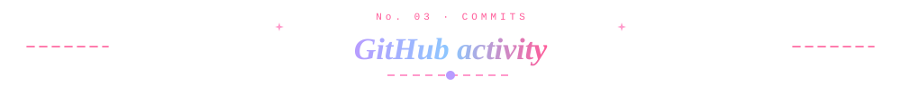</picture></h2>

<picture>
  <source media="(prefers-color-scheme: dark)" srcset="https://raw.githubusercontent.com/Jhanina03/Jhanina03/output/snake-dark.svg">
  
</picture>

<h2 id="about" align="center"><picture><source media="(prefers-color-scheme: light)" srcset="assets/light/h4.svg">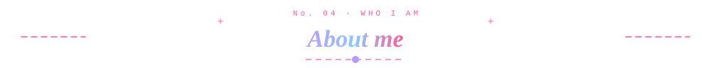</picture></h2>

  <picture><source media="(prefers-color-scheme: light)" srcset="assets/light/about.svg"></picture>

  🎨 Angular · TypeScript · Next.js &nbsp;|&nbsp; 🗄️ SQL Server · PostgreSQL · MongoDB &nbsp;|&nbsp; 🔍 Unit, integration &amp; mutation tests · Jenkins CI &nbsp;|&nbsp; 🧠 AI side projects

<h2 id="contact" align="center"><picture><source media="(prefers-color-scheme: light)" srcset="assets/light/h5.svg"></picture></h2>

  Open to <b>internships, junior roles and remote work</b> from Ambato, Ecuador. 
  Have a project or a role in mind? I'd love to hear about it.

  
  
  
  

<a href="https://jhanina03.github.io/"><picture><source media="(prefers-color-scheme: light)" srcset="assets/light/footer.svg"></picture></a>

<a href="#top">↑ Back to top</a>

