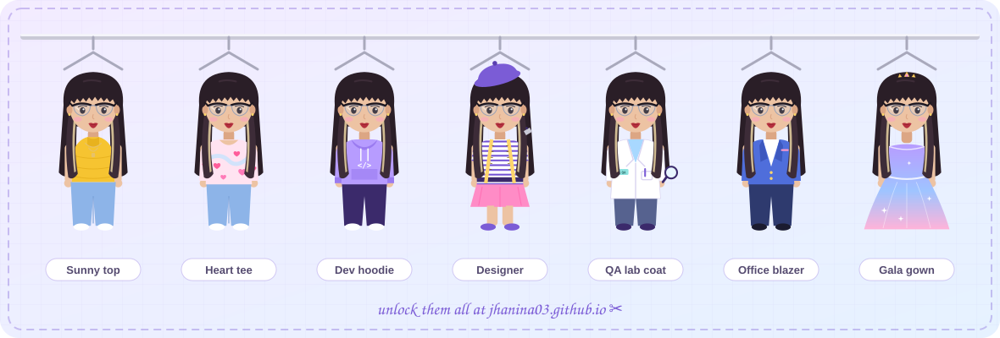
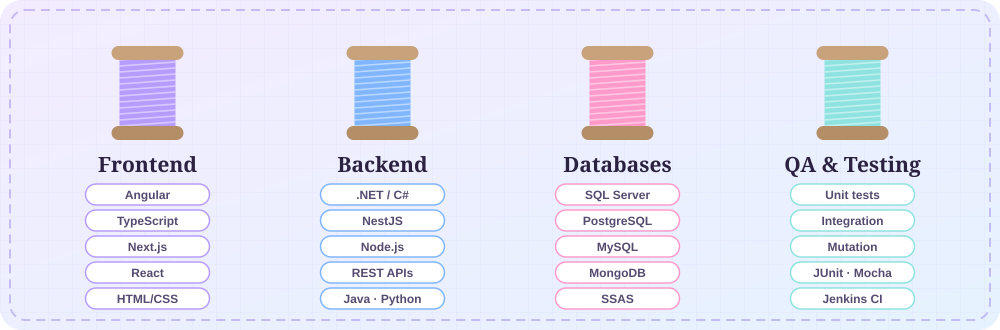
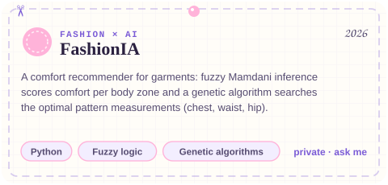
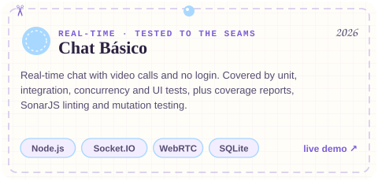
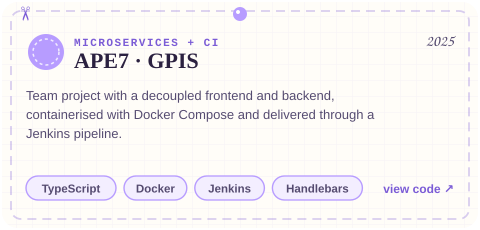
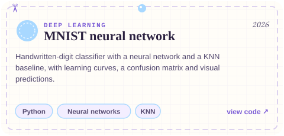
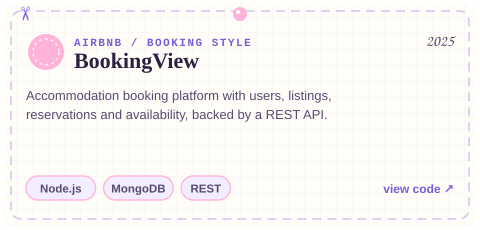
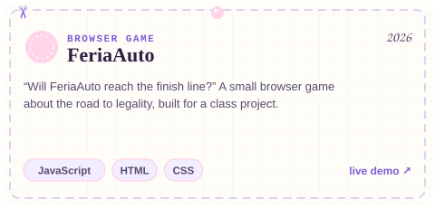
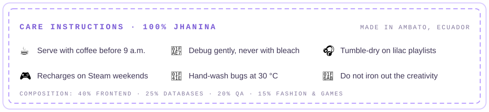

  
  
  

### 🧵 Hi, I'm Jhanina

I'm an 8th-semester **Software Engineering** student at Universidad Técnica de Ambato (Ecuador) 🇪🇨. I tailor software the way designers tailor clothes: **measured, tested and made to fit**.

- 🎨 **Frontend** with Angular + TypeScript, Next.js and React
- 🗄️ **Databases**: SQL Server, PostgreSQL, MySQL and MongoDB. I like my schemas tidy and my queries fast
- 🔍 **QA & testing**: unit, integration and mutation tests, code reviews, and CI with Jenkins
- 🧠 **AI**: neural networks, license-plate recognition and fuzzy logic + genetic algorithms
- 👗 Fashion lover. I'm always looking for ways to mix style and code (see **FashionIA**)
- 📍 Ambato, Ecuador · open to **remote** internships, junior roles and freelance work

🇪🇸 <b>En español</b>

Soy estudiante de 8.º semestre de **Ingeniería de Software** en la Universidad Técnica de Ambato. Confecciono software como un diseñador confecciona ropa: **a medida, probado y hecho para quedar perfecto**. Me especializo en **frontend** (Angular, TypeScript), **bases de datos** (SQL Server, PostgreSQL, MongoDB) y **QA**. También me encantan la IA y la moda. Disponible para prácticas, puestos junior y trabajo remoto.

### 👗 My wardrobe

Every section of my portfolio unlocks a new look. Can you collect all seven?

### 🪡 My thread collection

  

### ✂️ Featured collection

  <a href="https://jhanina03.github.io/archive.html#fashion"><picture><source media="(prefers-color-scheme: dark)" srcset="cards/fashionia-dark.svg"></picture></a>
  <a href="https://github.com/Jhanina03/chat-basico"><picture><source media="(prefers-color-scheme: dark)" srcset="cards/chat-dark.svg"></picture></a>
  <a href="https://github.com/Jhanina03/APE7-proyectogpis"><picture><source media="(prefers-color-scheme: dark)" srcset="cards/gpis-dark.svg"></picture></a>
  <a href="https://github.com/Jhanina03/mnist"><picture><source media="(prefers-color-scheme: dark)" srcset="cards/mnist-dark.svg"></picture></a>
  <a href="https://github.com/Jhanina03/BookingView"><picture><source media="(prefers-color-scheme: dark)" srcset="cards/booking-dark.svg"></picture></a>
  <a href="https://feriauto-juego.vercel.app"><picture><source media="(prefers-color-scheme: dark)" srcset="cards/feriauto-dark.svg"></picture></a>

Also: **license-plate recognition** (computer vision), an **account-reconciliation system** built during my internship at a financial institution, and **hotel booking modules on Odoo**.

👉 See them all in the **[pattern archive](https://jhanina03.github.io/archive.html)**, or play my sewing mini-game **[Sew the dress 🎮](https://jhanina03.github.io/game.html)**.

### 🧵 My contributions, stitched

<picture>
  <source media="(prefers-color-scheme: dark)" srcset="https://raw.githubusercontent.com/Jhanina03/Jhanina03/output/snake-dark.svg">
  
</picture>

### 📊 Stats

  
  

### 💌 Let's make something that fits

  
  
  
  

