  
  
  

### 🧵 Hi, I'm Jhanina

I'm an 8th-semester **Software Engineering** student at Universidad Técnica de Ambato (Ecuador) 🇪🇨. I tailor software the way designers tailor clothes: **measured, tested and made to fit**.

- 🎨 **Frontend** with Angular + TypeScript, Next.js and React
- 🗄️ **Databases**: SQL Server, PostgreSQL, MySQL and MongoDB. I like my schemas tidy and my queries fast
- 🔍 **QA & testing**: unit, integration and mutation tests, code reviews, and CI with Jenkins
- 🧠 **AI**: neural networks, license-plate recognition and fuzzy logic + genetic algorithms
- 👗 Fashion lover. I'm always looking for ways to mix style and code (see **FashionIA**)
- 📍 Ambato, Ecuador · open to **remote** internships, junior roles and freelance work

🇪🇸 <b>En español</b>

Soy estudiante de 8.º semestre de **Ingeniería de Software** en la Universidad Técnica de Ambato. Confecciono software como un diseñador confecciona ropa: **a medida, probado y hecho para quedar perfecto**. Me especializo en **frontend** (Angular, TypeScript), **bases de datos** (SQL Server, PostgreSQL, MongoDB) y **QA**. También me encantan la IA y la moda. Disponible para prácticas, puestos junior y trabajo remoto.

### 🪡 My thread collection

   
   
  

### 👗 Featured collection

| Project | What it is | Stack |
|---|---|---|
| **FashionIA** | Garment comfort recommender: fuzzy Mamdani inference + genetic algorithm for optimal pattern measurements | Python |
| [**Chat Básico**](https://github.com/Jhanina03/chat-basico) | Real-time chat with video calls, covered by unit, integration and mutation tests · [demo](https://chat-basico.onrender.com) | Node.js · Socket.IO · WebRTC |
| **License plate recognition** | Detects and reads vehicle license plates from images | Python · computer vision |
| **Account reconciliation system** | Internship project at a financial institution: cross-checks balances and flags mismatches | SQL · .NET |
| **Hotel booking on Odoo** | Booking sites and custom ERP modules | Odoo · Python |
| [**APE7 · GPIS**](https://github.com/Jhanina03/APE7-proyectogpis) | Decoupled app with Docker Compose and a Jenkins pipeline | TypeScript · Docker |
| [**MNIST**](https://github.com/Jhanina03/mnist) | Handwritten-digit neural network vs. KNN | Python |

👉 See them all in the **[pattern archive](https://jhanina03.github.io/archive.html)**.

### 📊 Stats

  
  

### 💌 Let's make something that fits

  
  
  
  

✂︎ Care instructions: serve with coffee, debug gently, never iron out the creativity.
